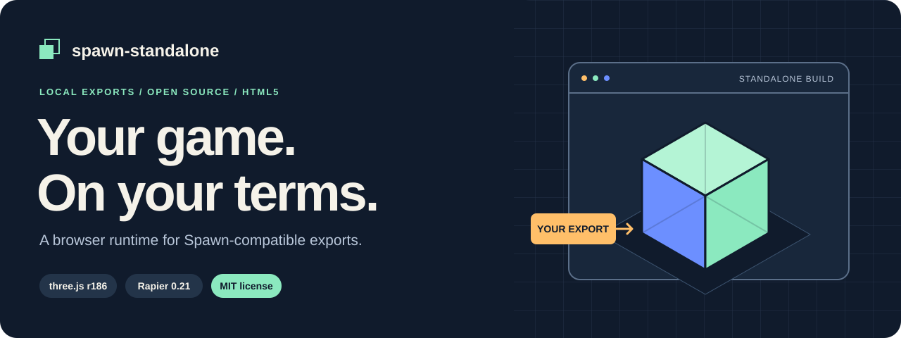
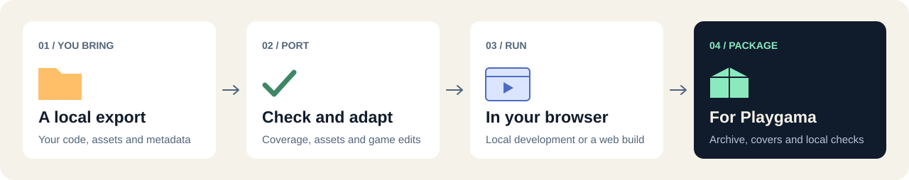

# spawn-standalone

**Take a local Spawn-compatible game export and build a standalone HTML5 game.**

This project provides the runtime, converter and packaging tools. You supply the game export, assets and any game-specific porting work. The converter works with local files and never signs in to Spawn or downloads a game for you.

**MIT licensed** · **Node.js 24+** · **Source release v1.0.0**

[Quick start](#quick-start) · [Capabilities](#what-it-can-do) · [Limits](#what-it-cannot-do-yet) · [Requirements](#what-you-need-to-provide) · [Porting guide](docs/porting.md)



## What it can do

| Capability | What you get |
| --- | --- |
| **Import a local export** | A runnable starter page, repeatable imports and a record of your porting edits. |
| **Run a browser game** | A three.js renderer, Rapier physics, camera/input, audio, UI hosting and supported Spawn-style builtins. Rendering and physics are enabled by the generated host. |
| **Check compatibility** | A report of used APIs, unsupported calls and import drift, plus asset indexing and hash verification. Partial API support is reported for your review. |
| **Keep work off the main thread** | Geometry and FX workers, plus host-configured local job modules. |
| **Connect local state and services** | Save/storage helpers and optional SQL, jobs, music, achievements and leaderboard ports. Games provide their own schemas, content and service implementations. |
| **Build and package** | A local dev server, a standalone web build, and a Playgama archive with credits, screenshots, covers and offline checks. |

The included sample is **synthetic test content**: a small interactive scene for checking the toolchain. No finished games or original game assets are bundled.

## What it cannot do yet

| Limit | What that means for your project |
| --- | --- |
| **Not every Spawn API is implemented** | Read the [capability manifest](packages/runtime/capabilities/capabilities.json). Some APIs have partial behavior; others are absent or throw. A passing coverage check still requires review of partial results. |
| **No automatic visual or gameplay parity** | Test your own game and tune its materials, lighting, animation, controls and gameplay. Import success is not proof of a finished port. |
| **No Spawn-hosted backend** | Hosted rooms, cross-world/room travel, cloud services, purchases and trading are not supplied. Local place transitions are supported; networked services require your own implementation and integration. |
| **No automatic game extraction** | A Spawn URL or account login is not an export. Bring a complete local export with its metadata and assets. |
| **No automatic platform approval** | Playgama packaging checks run locally. Live Bridge/ads, platform acceptance, physical mobile and your target browsers still need testing. |
| **No npm registry release yet** | Build from this source or install the four matching local archives. Do not assume the package names are available on npm. |

See the [runtime API](docs/api.md) for exact options and the [verification scope](docs/verification.md) for what local tests establish.

## What you need to provide

| You bring | Details |
| --- | --- |
| **Development tools** | Git, Node.js **24 or newer**, npm, and a modern browser. The local rendering checks use WebGL2. The initial dependency install needs internet access. |
| **Your game export and rights to its content** | For a real port: `export-info.json`, `source/`, `asset-manifest.json` and `assets/cdn/`. Engine documentation in `reference/` is optional. Keep the export intact. |
| **Porting and testing work** | Review coverage, record edits, choose save keys, configure UI/controls and test the game. This is a developer toolchain, not a one-click conversion service. |
| **Optional adapters** | Supply SQL schemas, job modules and any music, achievement, leaderboard or backend integration your game needs. Touch controls require a game-specific scheme. |
| **Chromium for automated checks** | Install Playwright Chromium for the test suite and automated screenshot/cover generation. Playing a web build uses your normal browser. |

You can try the synthetic sample below **without a real game export**.

## Quick start

### 1. Get and build the tools

```sh
git clone https://github.com/xenxenxen00/spawn-standalone.git
cd spawn-standalone
npm ci --no-audit --no-fund
npm run build:packages
```

### 2. Try the included synthetic sample

Run these from the repository root:

```sh
node --input-type=module -e 'import { createFixtureExport } from "@spawn-standalone/testing"; createFixtureExport(".cache/fixture-export");'
node packages/cli/src/bin.ts init .cache/fixture-export --name fixture-world --out .cache/fixture-world
node packages/cli/src/bin.ts import .cache/fixture-world
node packages/cli/src/bin.ts coverage .cache/fixture-world --check --json
node packages/cli/src/bin.ts assets build .cache/fixture-world
node packages/cli/src/bin.ts assets verify .cache/fixture-world
node packages/cli/src/bin.ts build .cache/fixture-world --target web
node packages/cli/src/bin.ts dev .cache/fixture-world
```

Open the local address printed by `dev`. Stop the server before the next step.

### 3. Optionally package it for Playgama

```sh
npx --no-install playwright install chromium
node packages/cli/src/bin.ts package .cache/fixture-world --target playgama
```

The package command produces an archive, credits, screenshots, covers and reports. For your own game, follow the [porting guide](docs/porting.md) and test the result on the target platform.

`init` refuses to overwrite an existing scaffold. `import` owns the generated `game/` tree and may remove files that are absent from a fresh import. Keep manual changes in the ordered edit ledger or host files outside that tree. Use `import --check` to detect drift.

## The four packages

| Package | Role |
| --- | --- |
| `@spawn-standalone/runtime` | Kernel, rendering, physics, input, audio, UI and host ports |
| `@spawn-standalone/vite` | World/content compilation and browser worker integration |
| `@spawn-standalone/cli` | Import, coverage, assets, build, dev server and Playgama packaging |
| `@spawn-standalone/testing` | Synthetic local export fixture |

For use outside this repository, install all four matching **1.0.0 archives** together and use `npx --no-install spawn-standalone` in place of `node packages/cli/src/bin.ts`. The [external-install guide](docs/porting.md#install-outside-the-monorepo) explains the package verification workflow. TypeScript hosts also need the declaration dependencies listed in the [API guide](docs/api.md).

<details>
<summary>TypeScript host dependencies</summary>

The strict external-install check uses these declaration packages:

```sh
npm install --save-dev typescript@7.0.2 @types/node@24.19.1 @types/three@0.186.0 @types/sql.js@1.4.11
```

</details>

## Check your setup

```sh
npx --no-install playwright install chromium
npm run check
npm run audit:source
npm run release:check -- --out ../release-candidates
```

`check` builds the JavaScript and declarations, then runs type checks, source boundary checks and tests. Rebuild after source edits: workspace imports resolve compiled entries.

`audit:source` scans publishable files, staged blobs and reachable Git history for known credential patterns and prohibited content paths. Findings contain locations without matched file contents. It is a focused release-content guard, not an exhaustive security assessment.

`release:check` audits the four actual archives, installs them **outside the checkout**, checks their public TypeScript declarations and exercises the installed CLI, workers, SQL, input, assets and browser sample. Its external install uses npm's cache offline; run the initial dependency install first. These commands do not publish packages or upload source.

**Windows:** use writable local `TEMP`/`TMP` folders and `VITEST_MAX_WORKERS=1` for a single browser lane. `PLAYWRIGHT_BROWSERS_PATH` can select an existing browser cache. A skipped browser test does not count as browser verification.

## Documentation and licensing

- [Port a local export](docs/porting.md) — export format, imports, edits and packaging.
- [Runtime API](docs/api.md) — composition, ports and opt-in behavior.
- [Capability manifest](packages/runtime/capabilities/capabilities.json) — implemented, partial and unavailable surfaces.
- [Verification](docs/verification.md) — local checks, hardware testing and their limits.
- [Provenance](docs/provenance.md) — the boundary between library source and game content.

Project code is [MIT licensed](LICENSE). Dependencies and adapted third-party code retain their [own notices](THIRD_PARTY_NOTICES.md). Your game and assets retain their own licenses. The public source excludes game workspaces, exported game assets, private history and the original game acceptance corpus.

This is an independent compatibility runtime, unaffiliated with Spawn. Publishing this source does not publish the npm packages or deploy a playable game.
